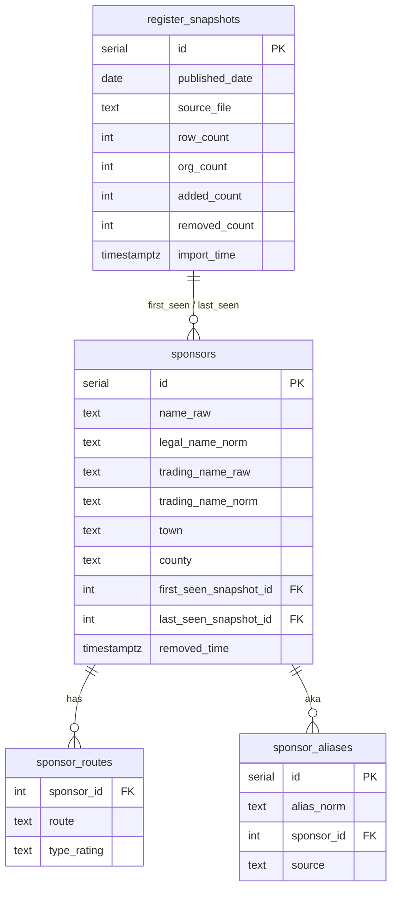

# Job Sponsor Tracker

Check whether a UK company holds a visa sponsor licence, and extract the visa wording from a job ad.

**Live site:** [tracker.ycrainyu.com](https://tracker.ycrainyu.com)

## Features

- **Sponsors** (`/`): Search the Home Office register of licensed sponsors by company name. Matches typos, trading names and known brand aliases, and shows each company's rating and visa routes.
- **Analyse** (`/analyse`): Paste a job ad to see what it says about visa sponsorship, quoted from the ad. Also extracts salary, work mode, years of experience and skills. Rule-based, no AI.

## Tech stack

```
Browser → Vercel (Next.js) → /api/* rewrite → Caddy → FastAPI → PostgreSQL
```

- **Frontend**: Next.js 16, TypeScript, Tailwind CSS, shadcn/ui, TanStack Query, next-intl
- **Backend**: Python 3.13, FastAPI, SQLAlchemy 2.0, Alembic
- **Database**: PostgreSQL 17, `pg_trgm` for fuzzy company name search
- **Deployment**: Vercel (frontend), AWS EC2 with Docker Compose (backend), Caddy (HTTPS), Cloudflare (DNS)
- **CI**: GitHub Actions (ruff, pytest, ESLint, Prettier, builds)

The browser only calls `/api/*` on the frontend's domain, and Vercel forwards those requests to the backend, so no CORS setup is needed. The frontend's API types are generated from the backend's OpenAPI schema.

## Run locally

Requirements: Docker, Node.js 22, pnpm 9, [uv](https://docs.astral.sh/uv/)

```bash
cp .env.example .env
docker compose up -d                  # PostgreSQL and API on http://localhost:8000
cd web && pnpm install && pnpm dev    # http://localhost:3000
```

The database starts empty. To load sponsor data, download the latest CSV from the [register page](https://www.gov.uk/government/publications/register-of-licensed-sponsors-workers) and import it:

```bash
cd api
uv run python -m app.cli import-register path/to/register.csv --published YYYY-MM-DD
uv run python -m app.cli import-aliases ../data/aliases.csv
```

Tests: `uv run pytest` in `api/`, and `pnpm lint && pnpm build` in `web/`.

## Data model



- `sponsors`: unique on `(name_raw, town)`. Trigram indexes sit on the normalised name columns.
- `removed_time`: set when a company drops off a later register import. The row is kept.

## Data and licence

- Sponsor data: [Register of licensed sponsors: workers](https://www.gov.uk/government/publications/register-of-licensed-sponsors-workers), Home Office. Contains public sector information licensed under the [Open Government Licence v3.0](https://www.nationalarchives.gov.uk/doc/open-government-licence/version/3/).
- Code: [MIT License](LICENSE)

Unofficial project. Not affiliated with the Home Office and not immigration advice.
