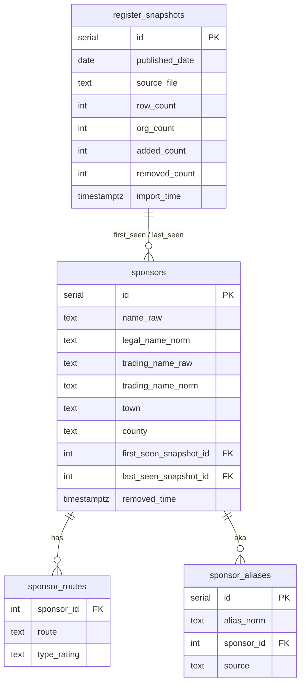

# job-sponsor-tracker

Track job applications and check UK visa sponsors.

Work in progress.

## Sponsor register

- `sponsors`: unique on `(name_raw, town)`. Trigram indexes sit on the normalised name columns.

- `removed_time`: set when a company drops off a later register import (row kept)

Source: [Register of licensed sponsors: workers](https://www.gov.uk/government/publications/register-of-licensed-sponsors-workers) (OGL v3.0).
